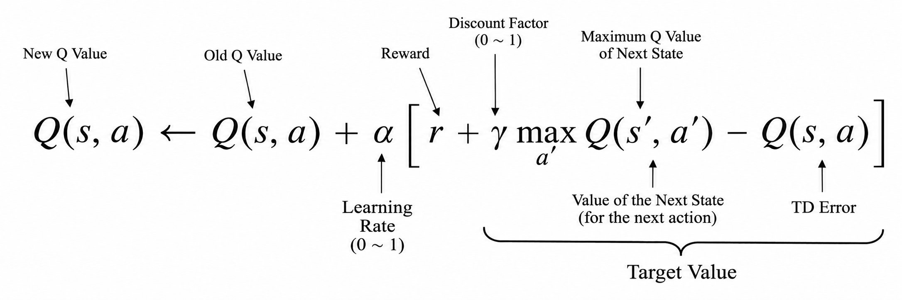

# Nim avec un agent basé sur le Q-learning

Jeu de Nim en console où le joueur affronte une intelligence artificielle. L'agent apprend à choisir ses coups en jouant plusieurs parties contre lui-même avant le début de la partie.

## Fonctionnalités

- Quatre piles contenant initialement **1, 3, 5 et 7 jetons**.
- Retrait d'un ou plusieurs jetons d'une seule pile à chaque tour.
- Choix aléatoire du joueur qui commence.
- Entraînement de l'IA par Q-learning avant la partie.
- Affichage des piles et du gagnant dans la console.

## Comment jouer

1. Lance le programme et attends la fin de l'entraînement de l'IA (`Done training`).
2. À ton tour, repère les piles affichées et entre l'indice de la pile à jouer. Les indices commencent à `0`.
3. Entre le nombre de jetons à retirer de cette pile.
4. Continue à jouer à tour de rôle avec l'IA jusqu'à la fin de la partie.

Exemple de coup :

```text
Piles:
Pile 0: 1
Pile 1: 3
Pile 2: 5
Pile 3: 7

Your Turn
Choose Pile: 3
Choose Count: 2
```

Ici, le joueur retire 2 jetons de la pile 3. Le coup est accepté si l'indice de pile existe et si le nombre choisi est compris entre `1` et le nombre de jetons présents dans cette pile. Une saisie invalide est refusée et le programme redemande un coup.

La partie s'arrête lorsque toutes les piles sont vides ; le résultat est ensuite affiché. Dans cette variante, le joueur qui retire le dernier jeton perd.

## Algorithme de l'IA

L'IA apprend par **Q-learning**, une méthode d'apprentissage par renforcement. Elle ne reçoit pas une stratégie prédéfinie : elle estime progressivement quels coups sont favorables en jouant contre elle-même.

### États et actions

- Un **état** décrit le nombre de jetons restant dans chaque pile. Par exemple, `[1, 1, 3, 5]` signifie qu'il reste respectivement 1, 1, 3 et 5 jetons.
- Une **action** est un couple `(i, j)` : retirer `j` jetons de la pile d'indice `i`. Par exemple, `(3, 2)` retire 2 jetons de la pile 3.
- La table Q mémorise une valeur pour chaque couple état-action. Une valeur élevée indique un coup estimé favorable ; une valeur faible indique un coup à éviter. Les couples encore inconnus commencent avec la valeur `0`.

### Récompenses et mise à jour

Après chaque coup, l'agent met à jour la valeur Q en combinant la récompense immédiate et l'estimation des récompenses futures :

```text
Q(s, a) ← Q(s, a) + α × [r + max Q(s', a') - Q(s, a)]
```

`s` est la configuration des piles avant le coup, `a` le coup choisi et `s'` la nouvelle configuration. `r` est la récompense immédiate : `-1` pour le coup qui fait perdre la partie, `+1` pour le coup précédent qui conduit à la victoire, et `0` tant que la partie continue. `max Q(s', a')` représente la meilleure valeur connue parmi les coups possibles ensuite ; elle vaut `0` s'il n'y a plus de coup possible.

Le paramètre `α` (taux d'apprentissage, `0.5` par défaut) règle à quel point la nouvelle estimation modifie l'ancienne valeur Q. Pour ce projet, le facteur d'actualisation `γ` est fixé à `1`.



*L'image présente la formule générale ; dans ce projet, `γ` est fixé à `1`.*

### Exploration et choix des coups

Pendant l'entraînement, la stratégie **epsilon-greedy** équilibre exploration et exploitation : avec une probabilité `epsilon` (valeur par défaut : `0.1`), l'agent choisit un coup aléatoire pour essayer de nouvelles possibilités ; sinon, il choisit un coup ayant la meilleure valeur Q connue. En cas d'égalité, il départage les coups ex æquo au hasard.

Une fois l'entraînement terminé, l'IA joue sans exploration aléatoire et choisit un des coups ayant la meilleure valeur Q pour l'état courant. Elle peut toutefois rester imparfaite si elle n'a pas assez appris.

## Installation et lancement

```bash
python play.py
```

Le script entraîne l'IA sur 10 000 parties avant de démarrer la partie interactive. L'entraînement affiche la progression dans la console et peut prendre un moment.

## Régler l'apprentissage du modèle Q

Tu peux modifier le nombre de parties d'entraînement dans `play.py`, en changeant la valeur passée à `train` :

```python
ai = train(10000)
```

Remplace `10000` par le nombre de parties souhaité. Un nombre plus élevé donne à l'IA davantage d'occasions d'apprendre, mais rallonge l'entraînement avant la partie ; un nombre plus faible réduit le temps d'attente, mais peut donner une IA moins expérimentée.
